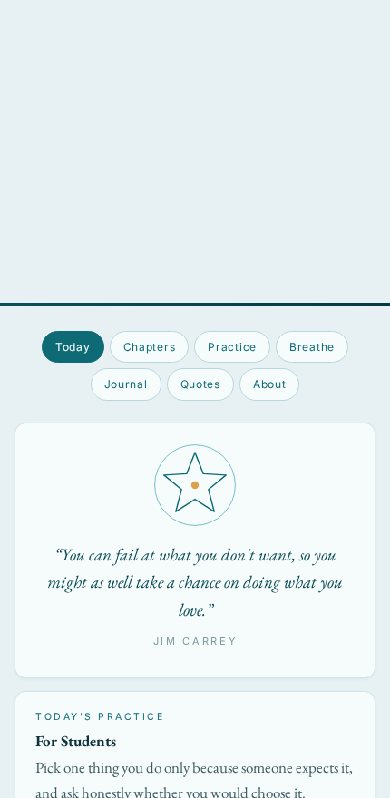
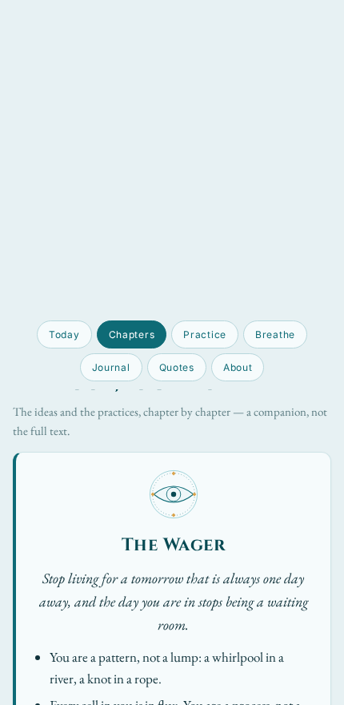
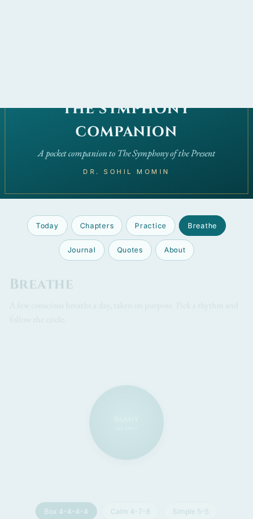
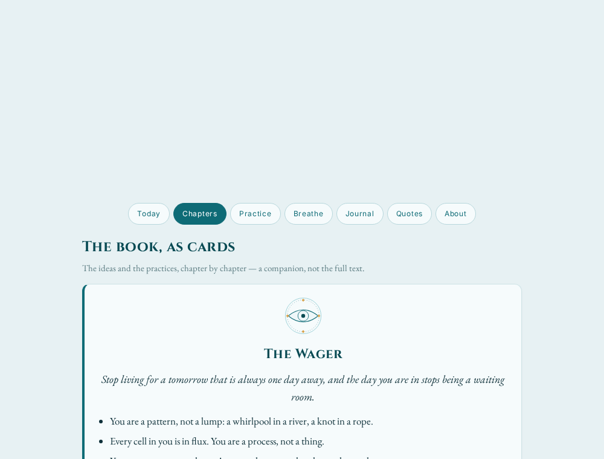

# The Symphony Companion

**A pocket companion to _The Symphony of the Present: Waking Up from the Illusion of Tomorrow_ by Dr. Sohil Momin.**

Not the book — a companion. The book's ideas as cards, its practices as a checklist, a breathing timer, a gratitude journal, and its attributed quotations.

---

<b>A pocket companion to <i>The Symphony of the Present: Waking Up from the Illusion of Tomorrow</i> by Dr. Sohil Momin.</b>

Not the book — a companion. The book's ideas as cards, its practices as a checklist, a breathing timer, a gratitude journal, and its attributed quotations.

---

## Use it

| | |
|---|---|
| **Online** | Open **[drsamonline.github.io/the-symphony-companion/play/](https://drsamonline.github.io/the-symphony-companion/play/)** |
| **Install (phone)** | Open the link, then **Share ▸ Add to Home Screen** (iOS) or **⋮ ▸ Install app** (Android). It then works offline. |
| **Offline / local** | Download `index.html` and open it in any browser. The whole app is one self-contained file — fonts, sigils and script are inlined, so it needs no server and no network. |

## What's inside

| Tab | What it does |
|---|---|
| **Today** | a daily quote and the day's practice (both rotate by date), plus a day-streak counter |
| **Chapters** | the book as cards: sigil, one-line idea, key points, *Your one move*, and an honest limit |
| **Practice** | every chapter's one move as a checklist |
| **Breathe** | an animated breathing timer — Box 4-4-4-4, Calm 4-7-8, Simple 5-5 |
| **Journal** | gratitude and notes, saved privately on your device, exportable as text |
| **Quotes** | the book's attributed lines |
| **About** | the book, the author, and a note on wellbeing |

## Documentation

- **[DOCUMENTATION.md](DOCUMENTATION.md)** — full guide: features, how it works, running and deploying it, customising it, privacy, accessibility, credits, FAQ.
- **[CHANGELOG.md](CHANGELOG.md)** — version history.
- **[LICENSE](LICENSE)** — the personal-use licence.

## Offline & installable

It's a Progressive Web App. A tiny service worker caches the app so it opens
offline after the first visit, and the manifest lets phones install it to the home
screen with its own icon. No app store, no build step.

## Privacy

There is **no account, no analytics and no network call**. Your streak and journal
live in your browser's local storage, on your own device. Nothing is uploaded, and
nothing is shared.

## Accessibility

The tabs are built with **pure CSS** (hidden radio inputs and labels), so the app
is fully navigable even with JavaScript turned off. Everything else degrades
gracefully — if a script is blocked, the content is shown rather than hidden.

## How it works

One self-contained `index.html` (HTML + CSS + a little vanilla JavaScript, no
frameworks, no dependencies, no build). Fonts and the chapter sigils are inlined,
so the file works entirely offline. See
[DOCUMENTATION.md](DOCUMENTATION.md#how-it-works) for the details.

## The book

> We are taught from childhood to sprint towards a future that exists only in our
> imagination. _The Symphony of the Present_ is an invitation to stop running.

**_The Symphony of the Present: Waking Up from the Illusion of Tomorrow_** —
**Dr. Sohil Momin**. Drawing on Alan Watts, Gabor Maté, Louise Hay and voices from
Freddie Mercury to Jim Carrey.

## A note on wellbeing

This companion offers general reflections on attention, identity and wellbeing. It
is **not** medical or psychological advice and is not a substitute for diagnosis or
treatment by a qualified professional. If you are in distress, please reach out to
a licensed clinician or a trusted person.

## Licence

**Copyright © 2026 Dr. Sohil Momin. All rights reserved.**

Free for **personal, non-commercial use**. **Not for commercial use.** See
[LICENSE](LICENSE) for the full terms.

Brief quotations from Alan Watts, Gabor Maté, Louise Hay, G. K. Chesterton, Jim
Carrey and Freddie Mercury remain the property of their respective rights holders
and are used briefly and with attribution.

MATNEO · The Symphony of the Present

